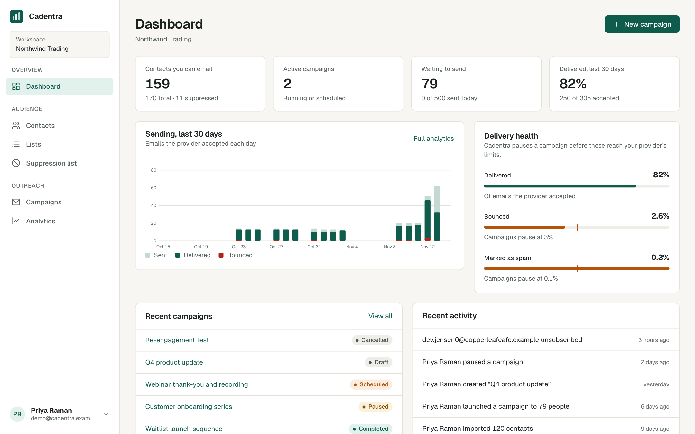
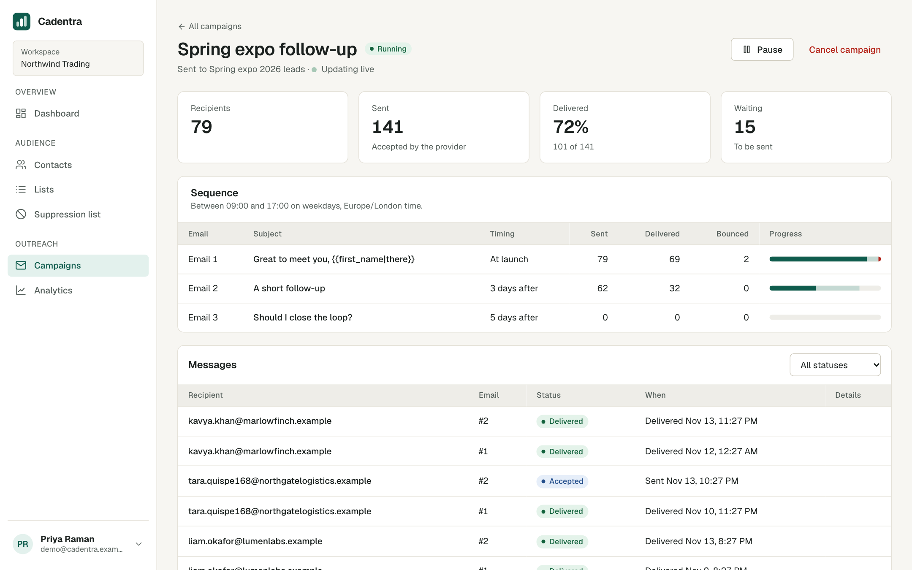
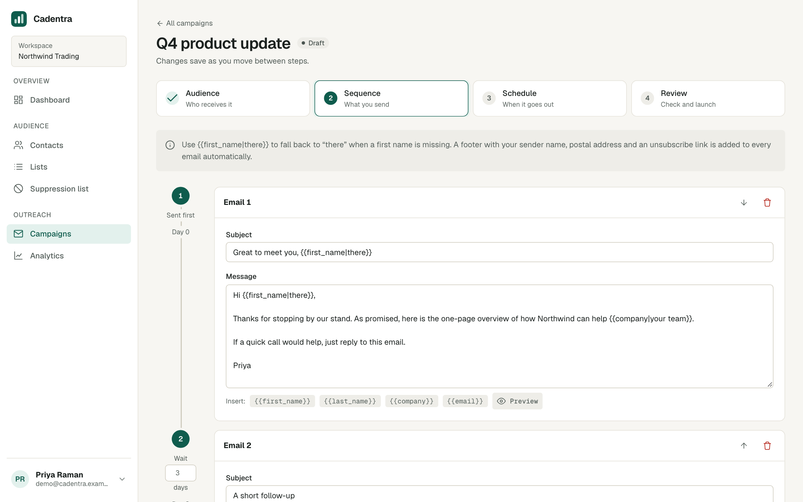
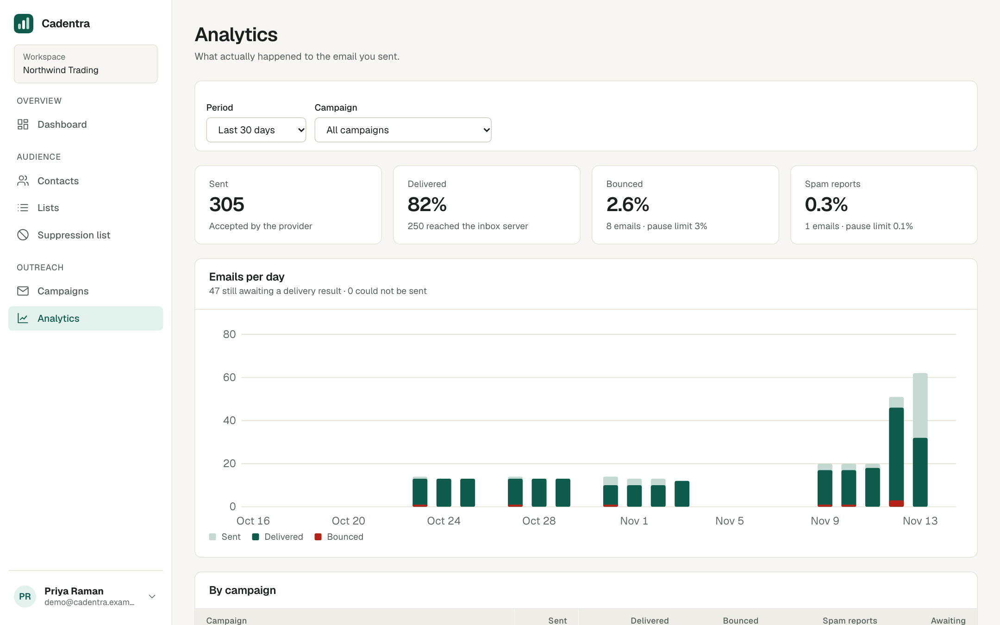
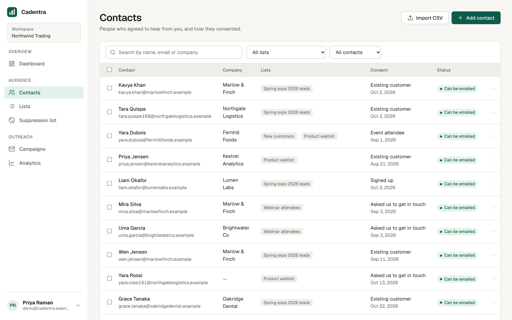

# Cadentra

A permission-based outbound email platform for small teams. Import contacts who agreed to hear from you, build a multi-step email sequence, schedule it, and see what actually happened to every message.



**Status:** feature-complete MVP, tested locally and in CI. **Not deployed.** The deployment configuration is written, the Docker image and the production Compose stack have been run and smoke-tested, and nothing is hosted yet. [docs/FINAL_MANUAL_SETUP.md](docs/FINAL_MANUAL_SETUP.md) lists the few account-dependent steps left; [docs/DEPLOYMENT.md](docs/DEPLOYMENT.md) records what is verified and what is not.

## What it does

- **Contacts and consent.** Every contact records how and when they consented. CSV import validates each row and reports exactly what was added, skipped or rejected.
- **Sequences.** A campaign sends an ordered series of emails with delays between them, inside a sending window in your time zone. Merge fields are validated when you save, so a typo never reaches a recipient.
- **Honest delivery states.** Messages are _scheduled, sending, accepted, delivered, bounced, complained, failed, skipped_ or _cancelled_. "Accepted" (the provider took it) is never confused with "delivered".
- **Safety by default.** Unsubscribes, bounces and spam reports suppress an address permanently. Suppression is checked again at the moment of sending. A campaign pauses itself when its bounce or complaint rate gets close to the provider's limits. Launch is blocked until the sender identity and postal address are set.
- **Account recovery.** Password reset and email confirmation use single-use, expiring links. Only a hash of each token is stored, the secret travels in the URL fragment so it never reaches server logs, and the forgot-password form answers the same for every address.
- **Analytics from real rows.** Every number comes from the message table. Opens are deliberately not tracked, because mail apps that preload images make them unreliable.

<table>
<tr>
<td></td>
<td></td>
</tr>
<tr>
<td></td>
<td></td>
</tr>
</table>

## Stack

Node.js 24, TypeScript 6, Express 5, MySQL 8.4 through Prisma 7, Zod, pino. The frontend is plain HTML, CSS and JavaScript modules with no build step. Tests use Vitest, Supertest and Playwright. Email goes through Resend behind a small interface, with an explicit fake provider for development and tests.

The background queue is the `email_messages` table itself, claimed with `FOR UPDATE SKIP LOCKED` and a lease (or, for MySQL-compatible databases without `SKIP LOCKED` such as TiDB, with one conditional `UPDATE` per message). There is no Redis. [docs/DECISIONS.md](docs/DECISIONS.md) explains why.

## Run it locally

Requires Node 24 and Docker.

```bash
npm install                 # also generates the Prisma client
cp .env.example .env        # then set APP_SECRET (openssl rand -hex 32)
npm run db:up               # MySQL 8.4 on port 3307
npm run db:deploy           # apply migrations
npm run db:seed             # optional: demo workspace with campaigns in every state
npm run dev
```

Open http://localhost:3000. With the seed, sign in as `demo@cadentra.example` / `cadentra-demo-2026`. Without it, create an account.

With the default `EMAIL_PROVIDER=fake` nothing is sent. Messages move through accepted, delivered and bounced as a simulation that mirrors Resend's test addresses (`delivered@`, `bounced@`, `complained@`), and Settings says so. To send real email, set `EMAIL_PROVIDER=resend` with your keys; see [docs/DEPLOYMENT.md](docs/DEPLOYMENT.md).

## Commands

| Command                                       | What it does                                                         |
| --------------------------------------------- | -------------------------------------------------------------------- |
| `npm run dev`                                 | Server with reload (also runs the worker)                            |
| `npm run typecheck` / `lint` / `format:check` | Static checks                                                        |
| `npm test`                                    | Unit and integration tests (integration needs the MySQL container)   |
| `npm run test:e2e`                            | Playwright end-to-end tests against a real server and database       |
| `npm run build` / `npm start`                 | Compile and run the production build                                 |
| `npm run smoke -- https://host`               | Smoke-test a running deployment                                      |
| `npm run db:migrate`                          | Create a migration after editing `prisma/schema.prisma`              |
| `npm run db:compat`                           | Check a MySQL-compatible host (TiDB) for the features Cadentra needs |
| `npm run resend:live`                         | Guarded, one-off live check of Resend (test addresses only)          |

## Configuration

All settings are environment variables, validated at startup. See [.env.example](.env.example).

| Variable                                                    | Purpose                                                                     |
| ----------------------------------------------------------- | --------------------------------------------------------------------------- |
| `DATABASE_URL`                                              | MySQL connection string (`?ssl=true` for hosted databases that need TLS)    |
| `APP_URL`                                                   | Public address, used in unsubscribe links. `https` required in production   |
| `APP_SECRET`                                                | At least 32 characters. Signs unsubscribe links                             |
| `EMAIL_PROVIDER`, `RESEND_API_KEY`, `RESEND_WEBHOOK_SECRET` | `fake` (default) or `resend`                                                |
| `RUN_WORKER`, `WORKER_*`                                    | Run the send worker in-process, and tune its pace                           |
| `TICK_TOKEN`                                                | Optional. Enables `POST /internal/tick` for hosts that sleep                |
| `TRUST_PROXY`                                               | Number of reverse proxies in front of the app (`1` on Render), else `false` |
| `QUEUE_CLAIM_MODE`                                          | `skip-locked` (MySQL 8, default) or `conditional-update` (TiDB)             |
| `SYSTEM_EMAIL_FROM`                                         | Sender of password-reset and confirmation mail. Required with `resend`      |
| `REQUIRE_VERIFIED_EMAIL`                                    | `true` to require a confirmed address before a campaign can launch          |

## Documentation

| Document                                                           | Contents                                                         |
| ------------------------------------------------------------------ | ---------------------------------------------------------------- |
| [Architecture](docs/ARCHITECTURE.md)                               | How the system fits together, the send pipeline, diagrams        |
| [Database design](docs/DATABASE_DESIGN.md)                         | Schema, constraints, indexes, transactions, concurrency findings |
| [API reference](docs/API_REFERENCE.md)                             | Every endpoint, with conventions and error codes                 |
| [Security](docs/SECURITY.md)                                       | Threats considered, controls, and known gaps                     |
| [Testing](docs/TESTING.md)                                         | Strategy, what is covered, results                               |
| [Deployment](docs/DEPLOYMENT.md)                                   | Hosting options, configuration, verification, what is untested   |
| [TiDB compatibility](docs/TIDB_COMPATIBILITY.md)                   | Audit of the free MySQL-compatible database and how to verify it |
| [Deployment automation audit](docs/DEPLOYMENT_AUTOMATION_AUDIT.md) | What was automated, what is verified, free-tier facts, risks     |
| [Final manual setup](docs/FINAL_MANUAL_SETUP.md)                   | The account-dependent steps that remain, in order                |
| [Decisions](docs/DECISIONS.md)                                     | Decision log with alternatives and trade-offs                    |
| [Product requirements](docs/PRODUCT_REQUIREMENTS.md)               | Scope, message and campaign lifecycles, design system            |
| [Research](docs/RESEARCH.md)                                       | Phase 0 findings, with verified facts separated from judgement   |
| [Roadmap](docs/ROADMAP.md)                                         | The ten phases as planned, and where they ended up               |

## Known limitations

- Not deployed, and real sending through Resend has not been exercised: no API key or verified domain was available. The Resend client is tested against a mocked `fetch`, and webhook handling against correctly signed payloads, but not against Resend itself.
- Email confirmation is sent but not enforced by default (`REQUIRE_VERIFIED_EMAIL`), because without a verified sending domain the provider can only reach the account owner's own address. There is no multi-factor authentication, and a workspace has a single owner (the `member` role exists in the schema but there are no invitations).
- Rate limiting is in memory, so it resets on restart and is per instance.
- Search matches email prefixes efficiently; name and company search scans one workspace's contacts, which is fine at the sizes this targets.

The complete list is in [docs/SECURITY.md](docs/SECURITY.md) and [docs/DEPLOYMENT.md](docs/DEPLOYMENT.md).
