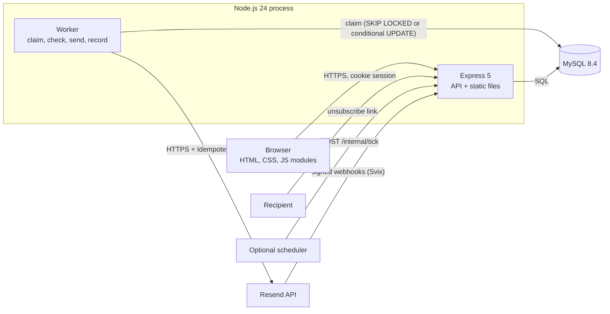
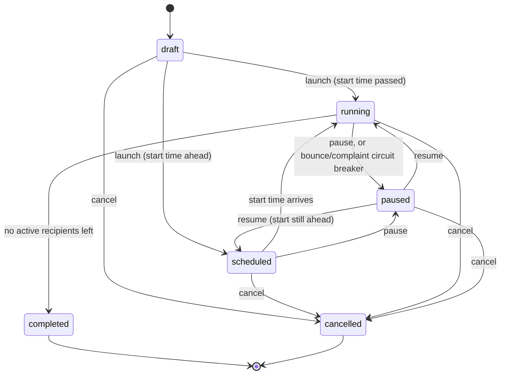

# Architecture

This describes the system as built. Earlier plans are in [ROADMAP.md](ROADMAP.md); the reasoning behind each choice is in [DECISIONS.md](DECISIONS.md).

## Shape of the system

One TypeScript codebase and one deployable. The same process serves the HTTP API, the static frontend, and (optionally) the send worker. `RUN_WORKER=false` turns the worker off for a web-only process.



The frontend is served by the API, so the browser talks to a single origin. That removes CORS and keeps cookie sessions simple.

## Code layout

```
src/
  server.ts              entry: config, DB, provider, worker, signals, graceful shutdown
  app.ts                 builds the Express app; no listening, so tests can use it directly
  config/env.ts          Zod-validated environment; the process exits on bad config
  lib/                   db client, errors, crypto, pagination, logger, small helpers
  middleware/            auth, CSRF, rate limits, error handler
  email/                 provider interface, Resend client, fake provider, compose, templates
  worker/                claim query, processor, retry policy, scheduling maths, health rules
  modules/
    auth/ workspace/ contacts/ lists/ suppression/ campaigns/
    analytics/ unsubscribe/ webhooks/ internal/ health/ activity/
  public/                the frontend (served as static files)
prisma/                  schema, migrations, seed
tests/                   unit/ and integration/ (Vitest)
e2e/                     Playwright specs
```

Each module has `*.routes.ts` (parse input, call a service, shape the response), `*.service.ts` (business rules and transactions), and `*.schemas.ts` (Zod). Services use Prisma directly. A separate repository file exists only where the query is non-trivial: `contacts.repository.ts` builds the raw SQL for the filtered contact list. A repository layer for every module would be ceremony here, so there isn't one. Pure logic with no I/O (state transitions, retry decisions, scheduling, health rules, analytics maths, templates) is in plain functions that unit tests call without a database.

## Request pipeline

`pino-http` (request id) → Helmet (strict CSP) → health and webhook routes → `/api/v1`: no-store header, CSRF check, rate limit, JSON body parser → module routers → central error handler.

Errors are `AppError` (status, code, message, optional field details) or `ZodError`, both rendered by one handler into `{ error: { code, message, details? } }`. Anything else becomes a generic 500 and is logged with the request id; stack traces never reach the client. Express 5 forwards rejected promises from async handlers to that handler, so route code has no try/catch boilerplate.

## Tenancy and authorization

Every business table carries `workspace_id`. The auth middleware resolves the session to `{ userId, workspaceId, role }` and services receive `workspaceId` as an argument. No endpoint lets the client choose a workspace. A resource that belongs to another workspace returns 404, not 403, so its existence is not revealed.

The database backs this up: tables that link two tenant-owned rows use composite foreign keys that include `workspace_id`, so a cross-tenant link cannot exist even if application code forgets a filter. See [DATABASE_DESIGN.md](DATABASE_DESIGN.md).

## Authentication

Registration creates the user, workspace and owner membership in one transaction and sends an email-confirmation link. Passwords use Argon2id (OWASP's minimum profile). A session is a 32-byte random token in an `HttpOnly`, `SameSite=Lax` cookie (`__Host-` prefixed and `Secure` when `APP_URL` is https). Only the SHA-256 hash of the token is stored, sessions expire after 7 idle days or 30 absolute days, and each can be revoked. Changing the password signs out every other session. Details in [SECURITY.md](SECURITY.md).

**Account recovery.** Password-reset and email-confirmation links carry a single-use token in the URL fragment (never sent to the server, so never in logs). Only its SHA-256 is stored in `auth_tokens`, with an expiry; spending it is a conditional update inside the transaction that changes the password, so two simultaneous uses cannot both win. The forgot-password endpoint answers identically for known and unknown addresses and sends the email after responding. These messages go through the same provider interface as campaigns, from `SYSTEM_EMAIL_FROM`, with no unsubscribe footer and no delivery simulation; a failure is logged and swallowed. A reset also confirms the address, and `REQUIRE_VERIFIED_EMAIL` can make confirmation a launch requirement.

## Campaign lifecycle



Transitions live in one table (`campaigns.lifecycle.ts`) and are applied with conditional updates (`UPDATE … WHERE id = ? AND status IN (…)`), so two concurrent requests cannot both win: the second sees zero affected rows and gets a 409. Drafts are edited under optimistic locking (`version`), so two browser tabs cannot silently overwrite each other.

**Launch** runs in one transaction: it flips the status, snapshots every non-suppressed contact on the list into `campaign_recipients` with `INSERT … SELECT`, and creates the first message for each. Either the campaign launches completely or not at all.

## The send pipeline

The queue is the `email_messages` table. A message is due when it is `scheduled`, its `run_at` has passed, and its campaign is `running`.

```mermaid
sequenceDiagram
  participant W as Worker
  participant DB as MySQL
  participant P as Provider
  loop every poll
    W->>DB: BEGIN; SELECT due rows FOR UPDATE SKIP LOCKED
    W->>DB: UPDATE status=sending, lease=now+5min, attempts+1; COMMIT
    W->>DB: re-check campaign, suppression, window, daily limit
    W->>P: send(email, Idempotency-Key = cadentra-message-<id>)
    P-->>W: provider message id
    W->>DB: BEGIN; status=accepted; create next step's message; COMMIT
  end
  P-->>DB: webhook: delivered / bounced / complained (signed)
```

**Claim.** A short READ COMMITTED transaction selects due rows with `FOR UPDATE SKIP LOCKED`, marks them `sending` with a lease, and commits. `SKIP LOCKED` lets several workers take different rows without waiting on each other. Two details matter and are covered by tests:

- The pool runs at READ COMMITTED. At MySQL's default REPEATABLE READ, the index range scan takes gap locks and concurrent claimers deadlock. The MariaDB driver adapter ignores Prisma's per-transaction `isolationLevel`, so the level is set when each connection opens.
- The query pins its plan (`FORCE INDEX (idx_messages_status_run_at)` and `STRAIGHT_JOIN`). Left alone, MySQL starts from the campaigns table and sorts, which locks _every_ due row before applying `LIMIT`, and the other workers then skip all of them.

**Claim without `SKIP LOCKED`.** With `QUEUE_CLAIM_MODE=conditional-update` (for TiDB and other MySQL-compatible databases that lack it) the claim reads candidate ids with no locks, shuffles them inside a small window, and claims each with a single `UPDATE … WHERE id = ? AND <still due> AND <campaign still running>`. The affected-row count decides who owns the message, so there is no multi-statement transaction and nothing depends on the isolation level. Contention errors (deadlock, write conflict) count as losing the race. The same tests run against both modes on MySQL. See [TIDB_COMPATIBILITY.md](TIDB_COMPATIBILITY.md).

**Re-check before sending.** Between the claim and the send things change, so the processor checks again: campaign still running, address not suppressed, recipient still active, inside the sending window, under the daily limit. A message outside its window is rescheduled to the next opening without counting as an attempt. An unsubscribe therefore takes effect even for messages that were scheduled days earlier.

**Send and record.** The provider call carries an idempotency key derived from the message id, and it never happens inside a database transaction, so a slow provider cannot hold row locks. On success one transaction marks the message `accepted`, stores the provider id, and creates the next step's message with `run_at` computed from the step's delay and the sending window (or completes the recipient if it was the last step).

**Duplicate prevention, three layers.**

1. `UNIQUE (recipient_id, step_id)` makes a second message for the same step and person impossible.
2. The lease: a `sending` message with an unexpired lease is not claimed again.
3. The provider idempotency key covers the one gap nothing else can: the provider accepts the email and the worker dies before recording it. The lease expires, another worker claims the message and sends again with the same key, and the provider returns the original result without sending a second email. This holds only inside the provider's 24-hour key window, so the lease (5 minutes) is far shorter.

**Retries.** The provider client classifies errors. Network failures, timeouts, 429, 409 and 5xx are retryable; other 4xx are permanent, with two refinements from Resend's documented error names: a daily or monthly quota error reschedules the message (daily: to 00:00 UTC) without using up an attempt, and an idempotency-key conflict (`invalid_idempotent_request`) is permanent, because retrying could duplicate an email that was already sent. Retryable failures back off 1 minute, 5 minutes, 30 minutes, 2 hours, honouring a longer `Retry-After`, and the message is `failed` after 5 attempts. The decision is a pure function with a table-driven test.

**Rate limiting.** A throttle keeps the send rate under the provider's limit (Resend allows 10 requests per second per team), concurrency is configurable, and the workspace's daily limit counts accepted plus in-flight messages.

**Shutdown.** On SIGTERM the HTTP server stops accepting connections, the worker stops claiming and waits (up to 10 seconds) for in-flight messages, then the pool closes; a 15-second timer forces exit if anything hangs. In the container, node runs as PID 1 (`exec node …` after the migration step) so it actually receives the signal; before that was fixed, `docker stop` waited out its grace period and killed the process (exit 137). A hard kill is still safe because of lease expiry plus the idempotency key.

## Webhooks and reconciliation

`POST /webhooks/resend` reads the raw body (the signature covers the exact bytes), verifies the Svix signature and timestamp, then:

1. inserts into `webhook_events` with `UNIQUE (provider, provider_event_id)`: a redelivered event is acknowledged and not reprocessed;
2. finds the message by `provider_message_id` and applies the event only if it moves the message _forward_ (`accepted < delivered < bounced/complained/failed`), so out-of-order and duplicate events cannot move a message backwards;
3. in one transaction, a bounce or spam report inserts a suppression and stops that recipient's remaining steps;
4. afterwards, if the campaign's bounce or complaint rate crosses its limit (with at least 20 sends), the campaign is paused with a recorded reason, and resuming it requires explicit acknowledgement.

An event for a message we cannot find yet (the webhook beat our own database write) is stored as `unmatched`, and applied by `reconcileUnmatchedEvents` as soon as the message's provider id is saved. A redelivery of an event that was stored but never applied (a crash between the two steps) is applied rather than discarded as a duplicate. Events that stay unmatched for a week, such as ones for account-recovery email sent through the same provider account, are deleted by the worker's housekeeping.

## Email providers

```ts
interface EmailProvider {
  readonly name: 'resend' | 'fake';
  send(email: OutboundEmail, idempotencyKey: string): Promise<SendResult>;
}
```

`ResendProvider` uses `fetch` against the documented REST API. `FakeProvider` is selected explicitly with `EMAIL_PROVIDER=fake`, sends nothing, honours idempotency keys like the real thing, can be told to fail, and simulates delivery events following Resend's test-address convention. The Settings page labels it as simulated. This is the only abstraction in the design; it exists because tests and local development need to run without a network.

Every message gets a footer with the sender name, postal address, the reason the recipient is being contacted (from their consent basis), and an unsubscribe link, plus `List-Unsubscribe` and `List-Unsubscribe-Post` headers. The one-click endpoint (`POST /u/:token`) accepts the mail client's request with no cookies.

## Frontend

Plain ES modules with no bundler and no framework: a small History API router, a fetch wrapper, a DOM builder (`h()`) that only ever inserts text as text nodes, and one module per page. Because all content goes through `textContent`, user data cannot inject markup, and the CSP forbids inline scripts and styles as a second layer. Dynamic widths use CSS custom properties set through the CSSOM, which the CSP allows. Charts are hand-written SVG with a text summary for screen readers. Styling is a token layer (`tokens.css`) plus base, component, layout and page stylesheets; Geist is self-hosted. See [PRODUCT_REQUIREMENTS.md](PRODUCT_REQUIREMENTS.md) for the design system.

## Observability

Structured JSON logs (pino) with a request id, secrets redacted. `/healthz` reports that the process is up; `/readyz` also checks the database. The worker logs each run that did work, with outcome counts, and each provider failure with its message id.
