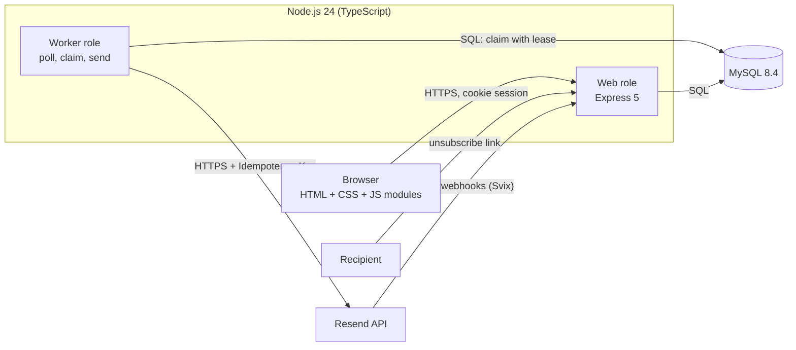

# Cadentra: Architecture

Status: proposal, awaiting review. Decisions and alternatives are in [DECISIONS.md](DECISIONS.md). Schema direction is in [DATABASE_DESIGN.md](DATABASE_DESIGN.md).

## 1. Shape of the system

One TypeScript codebase, one deployable, two roles. The same build starts either the **web process** (HTTP API plus static frontend) or the **worker process** (queue polling). In local development and on small hosts both roles can run in a single process. Splitting them later requires no code change, only a different start command.



The frontend is served by the same Express app, so the browser talks to one origin. That removes CORS configuration and makes cookie sessions simple and safer.

## 2. Backend layering

```
src/
  server.ts            process entry: load config, start roles, handle signals
  app.ts               builds the Express app (no listening; easy to test)
  config/env.ts        Zod-validated environment, fails fast at startup
  lib/                 logger, db client, small shared helpers
  middleware/          auth, tenant context, validation, rate limits, error handler
  modules/
    auth/              routes, service, schema (Zod), repository
    contacts/
    lists/
    campaigns/
    suppression/
    analytics/
    webhooks/
  email/               provider interface, Resend implementation, fake provider, rendering
  worker/              claim loop, message processor, retry policy, scheduler math
  public/              static frontend
tests/
```

Rules:

- **Routes** parse and validate the request, call a service, and shape the response. No business logic.
- **Services** hold business rules and transactions. They take the authenticated workspace id as an argument and never read it from the request body.
- **Repositories** are the only place that talks to Prisma or raw SQL. Every function takes `workspaceId`. A repository function that forgets it is a review failure.
- A module only gets a repository layer when it has real queries. Small modules may skip it and use the shared client in the service, to avoid ceremony.
- Pure logic (state transitions, send-time computation, retry classification, analytics maths) lives in plain functions with no I/O, so it is unit-testable without a database.

## 3. API conventions

- REST under `/api/v1`. JSON in and out. `Content-Type: application/json` is required on writes, except the CSV import which accepts `text/csv`.
- Success: `{ "data": ..., "meta": { "nextCursor": ... } }`. Error: `{ "error": { "code": "VALIDATION_FAILED", "message": "...", "details": [...] } }`.
- Status codes: 200, 201, 204, 400 (malformed), 401 (no session), 403 (authenticated but not allowed), 404 (not found, **also** returned for another tenant's resource, so existence is not leaked), 409 (conflict, such as a duplicate or an illegal state change), 422 (validation), 429 (rate limited).
- Cursor pagination for lists that can grow (contacts, messages, activity). Reason: offset pagination slows down as the offset grows and drifts when rows are inserted. Trade-off: no "jump to page 7".
- Zod schemas are the single source of truth for request shapes, and TypeScript types are derived from them with `z.infer`.
- One error class, `AppError`, with a code and HTTP status. A central error handler turns it into the response, logs unexpected errors with the request id, and never leaks stack traces in production.

## 4. Frontend architecture

Plain ES modules, no bundler, no framework.

```
public/
  index.html           single shell; loads css and js/main.js
  css/
    tokens.css         design tokens (colour, type, space, radius, motion)
    base.css           reset, typography, layout primitives
    components.css     buttons, inputs, table, badge, modal, toast...
  js/
    main.js            boot: auth check, mount shell, start router
    router.js          small hash-free History API router, route table
    api.js             fetch wrapper: JSON, error mapping, 401 handling
    state.js           tiny store for the current user and workspace
    ui/                toast.js, modal.js, table.js, badge.js, chart.js (SVG)
    pages/             login.js, dashboard.js, contacts.js, campaigns.js ...
```

- Each page module exports `render(container, params)` and returns a cleanup function.
- Text is inserted with `textContent` or an escaping template helper. Never `innerHTML` with user data. A strict content security policy (no inline scripts, no `eval`) is the second line of defence.
- Charts are small hand-written SVG. At most three chart types are needed, so a charting library would be most of the weight of the page for little gain.
- `// @ts-check` and JSDoc on the shared modules (`api.js`, `state.js`) so the editor catches mistakes without a build step. This is optional tooling, not a TypeScript migration.

## 5. Authentication and sessions

- Registration creates the user, a workspace, and an `owner` membership in **one transaction**. If any insert fails, none persists.
- Passwords: Argon2id. Login responds identically for "no such user" and "wrong password", and does comparable work in both cases to limit user enumeration by timing.
- Session: a 32-byte random token from `crypto.randomBytes`, sent as a cookie. Only the **SHA-256 hash** of the token is stored, so a database leak does not expose live sessions. Rows hold expiry and last-seen time, and can be revoked individually.
- Cookie attributes: `HttpOnly`, `Secure` (production), `SameSite=Lax`, `Path=/`, and the `__Host-` prefix in production.
- CSRF: `SameSite=Lax` is the baseline. State-changing requests additionally require a JSON content type (a cross-site HTML form cannot send one) and a matching `Origin` header check. I will compare this against OWASP's CSRF cheat sheet in Phase 3 and add a synchroniser token if the review says it is needed.
- Rate limiting: strict limit on login and registration by IP and by email, lower limits on writes, generous limits on reads. The in-memory store is acceptable for a single instance, and the limitation is documented.

## 6. Tenancy and authorization

Every business table carries `workspace_id`. The auth middleware loads the user's workspace membership and puts `workspaceId` and `role` on the request context. Services receive it as an argument. There is no endpoint where the client chooses a workspace id.

Defence in depth: join tables use **composite foreign keys** that include `workspace_id`, so the database itself refuses to link a contact from workspace A to a list in workspace B. Details in DATABASE_DESIGN.

The test suite has a dedicated authorization file: for every resource endpoint, a user from workspace B must receive 404 for workspace A's ids.

## 7. Background processing

### 7.1 Why a queue at all

A campaign with 500 contacts must not send 500 emails inside one HTTP request. The request would time out, and a crash halfway would leave an unknown state. Instead the request only records intent (rows in `scheduled` status), and a separate loop sends them later at a controlled rate.

### 7.2 The queue is the `email_messages` table

A message is due when `status = 'scheduled' AND run_at <= NOW()`. The worker loop:

1. **Claim.** In a short transaction: `SELECT ... WHERE status = 'scheduled' AND run_at <= NOW() ORDER BY run_at LIMIT n FOR UPDATE SKIP LOCKED`, then `UPDATE` those rows to `status = 'sending'`, `locked_by = <worker id>`, `locked_until = NOW() + 5 minutes`, `attempts = attempts + 1`. Commit. `SKIP LOCKED` lets several workers claim different rows without waiting on each other.
2. **Re-check.** Load the contact's suppression state, the campaign state, and the contact's membership. If suppressed or paused, mark `skipped` and stop. This is why an unsubscribe takes effect even for already-scheduled messages.
3. **Send.** Render the message and call the provider with `Idempotency-Key = message-<id>`.
4. **Record.** On success: store `provider_message_id`, set `accepted`, and, in the **same transaction**, create the next step's message row with `run_at = accepted_at + delay`, adjusted into the sending window. On failure: apply the retry policy.

A fallback for hosts where `SKIP LOCKED` is unavailable (possibly TiDB): claim with a single atomic `UPDATE ... WHERE id IN (...) AND status = 'scheduled'` and check the affected row count. Decided by a Phase 2 spike.

### 7.3 Duplicate-send prevention (three layers)

1. **Database:** `UNIQUE (campaign_recipient_id, campaign_step_id)` on `email_messages`. A step can only ever have one message row for a recipient, however many times the "create next step" code runs.
2. **Claim:** a message in `sending` with an unexpired lease cannot be claimed by another worker.
3. **Provider:** the `Idempotency-Key` header makes the provider return the original response for a repeated request within 24 hours. This covers the one gap nothing else can: the worker sends, the provider accepts, and the worker crashes before saving the result. The lease expires, the message is reclaimed, the same key is sent, and no second email goes out. The lease must therefore stay far below 24 hours.

### 7.4 Retry policy

| Outcome | Classification | Action |
| --- | --- | --- |
| Network error, timeout, 5xx | Transient | Retry |
| 429 | Transient | Retry after `retry-after` if present |
| 4xx other than 429 (invalid address, unverified domain, quota exceeded) | Permanent | `failed`, no retry |
| Lease expired while `sending` | Unknown outcome | Retry with the **same** idempotency key |

Backoff: 1 minute, 5 minutes, 30 minutes, 2 hours, then `failed` after 5 attempts. Each failure stores `last_error`. The classification is a pure function, unit-tested with a table of cases.

### 7.5 Scheduling

`computeRunAt(acceptedAt, delay, window, timezone)` is a pure function: add the delay, then move forward to the next allowed weekday and hour inside the workspace timezone. DST edges get explicit tests. The timezone library is chosen in Phase 7.

### 7.6 Concurrency, limits, shutdown

- Concurrency is a config value (default 2 in-flight sends). Sends are further limited by a token bucket so the process stays below Resend's 10 requests per second and below the workspace's daily cap. Free plan quota is 100 per day, so the default daily cap is conservative.
- **Circuit breaker:** after at least 20 accepted messages, if a campaign's bounce rate exceeds a threshold well below Resend's 4%, the campaign is paused with a recorded reason.
- **Graceful shutdown:** on SIGTERM or SIGINT the worker stops claiming, waits for in-flight sends to finish (bounded by a timeout), then closes the database pool and exits. A forced kill is still safe because of lease expiry plus the idempotency key.
- Housekeeping runs in the same loop: reclaim expired leases, delete expired sessions, trim old webhook payloads.

### 7.7 Why not BullMQ

See D-05. In short: it would add Redis with persistence and `noeviction`, create a dual-write problem between MySQL and Redis, and cost money to host, while this workload is small. The processing function is independent of the claim loop, so swapping is possible.

## 8. Email provider integration

```ts
interface EmailProvider {
  send(message: OutboundEmail, idempotencyKey: string): Promise<SendResult>;
}
```

One interface, two implementations: `ResendProvider` and `FakeProvider` (records sends in memory, can be told to fail, used in tests and local development). This is the only abstraction in the design, and it exists because tests need to run without the network and the provider's policy makes a second provider a realistic future need.

### Webhooks

`POST /webhooks/resend`:

1. Use `express.raw` for this route so the body is the exact bytes. A parsed-then-reserialised body breaks the signature.
2. Verify with the Svix scheme using `svix-id`, `svix-timestamp`, `svix-signature` and the webhook secret. Reject with 400 if invalid. The timestamp check gives replay protection.
3. Insert into `webhook_events` with `UNIQUE (provider, provider_event_id)` where the id is `svix-id`. A duplicate delivery hits the constraint and is acknowledged without reprocessing.
4. Find the message by `provider_message_id`. Apply the status change only if the new status is **later** in the lifecycle than the current one (`accepted < delivered`, with `bounced` and `complained` as terminal). Events arrive out of order, so this rule makes processing order-insensitive.
5. Side effects in one transaction: hard bounce or complaint inserts a suppression row and stops that recipient's remaining steps.
6. Return 2xx only after the transaction commits, so the provider retries on failure.

The Resend webhook secret is stored in an environment variable. It is never logged.

## 9. Security approach

| Risk | Control |
| --- | --- |
| Credential stuffing, brute force | Argon2id, rate limits on login by IP and by email, identical error messages |
| Session theft | HttpOnly, Secure, SameSite cookies, hashed tokens in the database, revocation, idle and absolute expiry |
| CSRF | SameSite=Lax, JSON-only writes, Origin check, reviewed against OWASP in Phase 3 |
| Broken access control, IDOR | Workspace scoping in every repository function, composite foreign keys, 404 for foreign ids, dedicated authorization tests |
| SQL injection | Prisma parameterisation. Raw SQL only through tagged templates with bound parameters |
| XSS | `textContent` and an escaping helper, strict CSP through Helmet, no inline scripts |
| Email header injection | Subject and addresses validated, newlines rejected before they reach the provider |
| Template injection | Merge fields are a fixed allow-list substituted as plain text, not an expression language |
| Abuse as a spam tool | Consent basis required, launch gates, daily caps, bounce circuit breaker, unsubscribe on every message |
| Forged webhooks | Svix signature verification on the raw body, timestamp tolerance |
| CSV upload abuse | Size cap, row cap, `text/csv` only, no formula or file handling server-side beyond parsing, per-row validation |
| Secrets exposure | Environment variables only, validated at startup, redacted in logs, `.env` ignored by Git |
| Dependency risk | Few dependencies, exact pins for Prisma and TypeScript, `npm audit` in CI |
| Denial of service | Request body limits, rate limits, pagination caps, query timeouts |

A full `SECURITY.md` is written in Phase 3 and revisited in Phase 9.

## 10. Observability

`pino` structured JSON logs with a request id, `pino-http` for access logs, redaction of `authorization`, cookies and any field named `password`, `token` or `secret`. Health endpoints: `/healthz` (process is up) and `/readyz` (database reachable). The worker logs each claim batch and each send outcome with the message id.

## 11. Testing strategy

| Level | Tooling | What it covers |
| --- | --- | --- |
| Unit | Vitest | Pure logic: state transitions, `computeRunAt`, retry classification, suppression rules, analytics maths, validators |
| Integration | Vitest, Supertest, real MySQL | Auth, authorization across tenants, contacts and CSV import, campaign lifecycle, the claim loop, webhook processing, using `FakeProvider` |
| End to end | Playwright | Register, import contacts, build and schedule a campaign, watch statuses change, unsubscribe |
| Manual sandbox | Resend test addresses | `delivered@`, `bounced@`, `complained@` verify the real integration once in Phase 7 and again after deployment |

Integration tests need MySQL. Locally that is a Docker Compose service. In CI it is a GitHub Actions service container.

Quality gates per phase: type check, lint, format check, tests, build. Nothing is pushed red.

## 12. Deployment topology (provisional)

One container image from a `Dockerfile`, one MySQL database, environment variables for configuration, an HTTPS endpoint, `/healthz` for the platform check. Provider choice and cost are decided in Phase 10 (see D-14 and the hosting table in RESEARCH).
