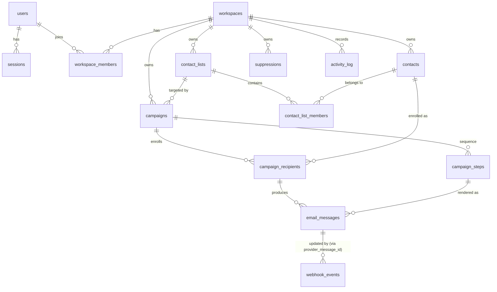

# Cadentra: Database Design (Draft v0)

Status: **draft direction**, written in Phase 0 and finalised in Phase 2 after a schema spike. Column lists below are intent, not final DDL. MySQL 8.4 with InnoDB, `utf8mb4`, strict SQL mode.

## 1. Design principles

1. **One source of truth per fact.** Whether an address may be emailed lives only in `suppressions`. `contacts` does not carry a second "unsubscribed" flag that could disagree with it.
2. **The database enforces tenancy**, not just the application. Cross-workspace links are impossible by constraint.
3. **State machines are constrained.** Status columns are `ENUM` or a `CHECK` list, and transitions are made with conditional `UPDATE ... WHERE status = ?`.
4. **Duplicates are prevented by unique keys**, never by "check first, then insert" alone.
5. **Indexes come from named query patterns** (section 5). No index without a query that needs it.
6. **Aggregates are computed, not stored.** Counts and rates are calculated from rows with an index plan, and only precomputed if measurement shows a need.

## 2. Entities and ownership

MVP entities. Deliberately omitted: a reusable `EmailSequence` entity (steps belong to a campaign), a separate `SequenceEnrollment` (it is `campaign_recipients`), an `UnsubscribeEvent` table (an unsubscribe is a suppression row plus an activity-log entry), and a job-metadata table (the queue is `email_messages`).

| Table | Owned by | Purpose |
| --- | --- | --- |
| `users` | global | Login identity. Email unique |
| `sessions` | user | Server-side sessions, token stored as SHA-256 hash |
| `workspaces` | global | Tenant. Holds sender identity, timezone, sending window defaults, daily cap |
| `workspace_members` | workspace and user | Membership with a role (`owner`, `member`). Primary key `(workspace_id, user_id)` |
| `contacts` | workspace | A person, with consent basis, consent source and consent time |
| `contact_lists` | workspace | Named group |
| `contact_list_members` | workspace | Contact belongs to list. Composite primary key |
| `suppressions` | workspace | Addresses that must not be emailed, with reason |
| `campaigns` | workspace | Name, status, target list, schedule, sending window, version |
| `campaign_steps` | campaign | Ordered steps: subject, body, delay in days from the previous step |
| `campaign_recipients` | campaign | One row per contact in the campaign. Holds per-contact sequence state |
| `email_messages` | campaign recipient and step | One row per message. **This is the queue** |
| `webhook_events` | provider | Raw provider events for idempotent processing and audit |
| `activity_log` | workspace | Append-only audit of important actions |

## 3. ER diagram



## 4. Key constraints (the part worth explaining in an interview)

### 4.1 Tenant isolation through composite foreign keys

Tables that link two tenant-owned rows store `workspace_id` as well, and the foreign keys include it:

```sql
-- parents expose (workspace_id, id) as a unique key
ALTER TABLE contacts      ADD UNIQUE KEY uq_contacts_ws_id      (workspace_id, id);
ALTER TABLE contact_lists ADD UNIQUE KEY uq_contact_lists_ws_id (workspace_id, id);

CREATE TABLE contact_list_members (
  workspace_id INT NOT NULL,
  list_id      INT NOT NULL,
  contact_id   INT NOT NULL,
  added_at     TIMESTAMP NOT NULL DEFAULT CURRENT_TIMESTAMP,
  PRIMARY KEY (list_id, contact_id),
  CONSTRAINT fk_clm_list    FOREIGN KEY (workspace_id, list_id)    REFERENCES contact_lists (workspace_id, id) ON DELETE CASCADE,
  CONSTRAINT fk_clm_contact FOREIGN KEY (workspace_id, contact_id) REFERENCES contacts      (workspace_id, id) ON DELETE CASCADE
);
```

Because both foreign keys carry the same `workspace_id`, a row linking workspace A's contact to workspace B's list cannot exist. A bug in the application that forgets a `WHERE workspace_id = ?` still cannot create a cross-tenant link. The same pattern applies to `campaign_recipients` (campaign and contact) and `campaigns.list_id`.

Cost: wider keys and slightly more verbose Prisma relations. First Phase 2 spike: confirm Prisma 7 can model these relations, or fall back to hand-edited migration SQL.

### 4.2 Uniqueness

| Constraint | Prevents |
| --- | --- |
| `users(email)` unique | Duplicate accounts |
| `contacts(workspace_id, email)` unique | Duplicate contacts. Email stored lower-cased, so comparison is case-insensitive without relying on collation |
| `contact_lists(workspace_id, name)` unique | Two lists with the same name |
| `suppressions(workspace_id, email)` unique | Duplicate suppression rows. Inserting an already-suppressed address becomes a no-op |
| `campaign_recipients(campaign_id, contact_id)` unique | The same person enrolled twice in one campaign |
| `email_messages(campaign_recipient_id, campaign_step_id)` unique | **Two messages for the same step and person.** The core duplicate-send guard |
| `email_messages(provider_message_id)` unique (nullable) | Two messages mapped to one provider id. Lets a webhook find exactly one row |
| `webhook_events(provider, provider_event_id)` unique | Reprocessing a redelivered webhook |
| `sessions(token_hash)` unique | Token collisions, and gives an index for lookup |
| `campaign_steps(campaign_id, position)` unique | Two steps at one position |

### 4.3 Not-null, types, and checks

- Timestamps are `TIMESTAMP` or `DATETIME(3)` in UTC, set by the database defaults (`created_at`, and `updated_at ... ON UPDATE`). The application converts to the workspace timezone only for display and for send-window maths.
- Emails: `VARCHAR(254)`, stored lower-cased and trimmed.
- Statuses: `ENUM` with the values listed in PRODUCT_REQUIREMENTS. Prisma maps these to TypeScript union types.
- `CHECK (delay_days BETWEEN 0 AND 60)`, `CHECK (attempts BETWEEN 0 AND 10)`, `CHECK (position >= 1)`. MySQL 8.0.16 or later enforces CHECK constraints. Prisma cannot declare them, so they are added by hand-edited migration SQL.
- Message body: `MEDIUMTEXT`. Rendered per-recipient content is **not** stored. It is rendered at send time from the step and contact, so edits to contact data do not leave stale copies. The subject actually sent is stored in `email_messages.subject_sent` for audit.

### 4.4 Deletion behaviour (deliberate, not defaulted)

| Parent deleted | Children | Reason |
| --- | --- | --- |
| user | `sessions` cascade | Sessions are meaningless without the user |
| workspace | everything cascades | Whole-tenant erasure. Not exposed in the MVP UI |
| contact | `contact_list_members` cascade. `campaign_recipients.contact_id` set null. `suppressions` **kept** | Removing someone's data must not delete the fact that they opted out. Analytics rows survive, with the personal fields cleared |
| list | `contact_list_members` cascade. A campaign that targets it blocks the delete (`RESTRICT`) | A running campaign must not lose its audience silently |
| campaign | draft only: steps, recipients cascade. Non-draft campaigns are cancelled, not deleted | Sent history is a record |

Open question for Phase 2: how `email_messages.to_email` is redacted when a contact is erased. Likely a nightly job, or immediate nulling in the delete transaction.

### 4.5 Concurrency

- **Optimistic locking** on `campaigns.version`. An edit sends the version it read. `UPDATE ... WHERE id = ? AND version = ?` that affects zero rows means someone else changed it, and the API returns 409. This is how two browser tabs avoid silently overwriting each other.
- **Conditional status updates** for transitions: `UPDATE campaigns SET status = 'paused' WHERE id = ? AND status = 'running'`. Affected rows tell you whether you won.
- **Row locks with `SKIP LOCKED`** for queue claims (ARCHITECTURE section 7.2).
- Default isolation level stays `REPEATABLE READ`. Transactions are short and never wrap a network call to the provider.

### 4.6 Primary key type

Leaning `INT AUTO_INCREMENT` for all tables. It is compact and ordered, which suits InnoDB's clustered index, and Prisma's `Int` avoids the `BigInt` JSON serialisation problem. The ceiling (about 2.1 billion rows) is far beyond this project. Sequential ids are guessable, so authorization must never depend on id secrecy. That is why every lookup is scoped by workspace. To be confirmed in Phase 2. `BIGINT` for `email_messages`, `webhook_events` and `activity_log` is the alternative.

## 5. Query patterns and indexes

Indexes below exist because a named query needs them. Each will be checked with `EXPLAIN` in Phase 2 and again in Phase 9.

| # | Query | Index |
| --- | --- | --- |
| Q1 | Claim due messages: `WHERE status='scheduled' AND run_at <= NOW() ORDER BY run_at LIMIT n` | `email_messages (status, run_at)` |
| Q2 | Reclaim expired leases: `WHERE status='sending' AND locked_until < NOW()` | Same index (leading column `status`) |
| Q3 | Contacts page: `WHERE workspace_id=? ORDER BY id DESC` with cursor `id < ?` | `contacts (workspace_id, id)`, which the composite unique key from 4.1 already provides |
| Q4 | Contact search by email prefix: `WHERE workspace_id=? AND email LIKE 'abc%'` | The unique key `(workspace_id, email)` serves prefix matches. Substring and name search accept a bounded scan within one workspace. A `FULLTEXT` index is post-MVP |
| Q5 | Contacts in a list: `WHERE list_id=?` | Primary key `(list_id, contact_id)`. Reverse lookup by contact needs `(contact_id)` |
| Q6 | Send-time suppression check: `WHERE workspace_id=? AND email=?` | The suppression unique key |
| Q7 | Campaign funnel: `GROUP BY status WHERE campaign_id=?` | `email_messages (campaign_id, status)` (denormalised `campaign_id` on the message, to avoid joining through recipients) |
| Q8 | Dashboard time series: messages by day in a workspace | `email_messages (workspace_id, created_at)` or `(workspace_id, accepted_at)`. Choose after measuring in Phase 8 |
| Q9 | Webhook lookup by provider message id | Unique index on `provider_message_id` |
| Q10 | Due recipients and next-step creation | `campaign_recipients (campaign_id, status)` |
| Q11 | Session lookup on every request | Unique `sessions (token_hash)`. A second index on `expires_at` for cleanup |
| Q12 | Activity feed: `WHERE workspace_id=? ORDER BY id DESC` | `activity_log (workspace_id, id)` |

Indexes I am deliberately **not** adding: a standalone `status` index on `contacts` (low selectivity), indexes on every foreign key beyond what InnoDB already creates, and any index on `body` columns.

## 6. Transaction boundaries

| Operation | Inside one transaction | Why |
| --- | --- | --- |
| Register | user, workspace, owner membership | No account without a workspace |
| CSV import | Per batch of rows: contact inserts and list membership | Partial progress is reported row by row. A failed batch does not leave half a batch |
| Launch campaign | Status change, recipient snapshot (`INSERT ... SELECT` from list members, **excluding suppressed addresses**), first message row per recipient | Launch is all or nothing |
| Claim messages | `SELECT ... FOR UPDATE SKIP LOCKED` plus the `UPDATE` to `sending` | Two workers cannot claim the same row |
| Record send success | Message to `accepted`, create next step's message, update `campaign_recipients` | Next step exists if and only if this one was recorded |
| Process webhook | Event insert, message status change, suppression insert, stop remaining steps | Duplicate-safe and consistent |
| Unsubscribe | Suppression insert, stop recipient steps, mark scheduled messages `skipped`, activity log | The opt-out is complete or not at all |

**Never** inside a transaction: the HTTP call to the provider. A slow provider must not hold row locks.

## 7. Retention

| Data | Retention |
| --- | --- |
| Expired sessions | Deleted by the worker housekeeping loop |
| `webhook_events.payload` | Cleared after 30 days. Event id and type remain for dedupe history |
| `email_messages`, `activity_log` | Kept, since they are the product's record |
| Suppressions | Kept indefinitely, since deleting them would allow re-mailing someone who opted out |

## 8. Seed data

Phase 2 provides a seed script for local development: one workspace, around 200 contacts in several lists, one campaign in each state, and messages in every status, so the dashboard has real rows to aggregate. Seed data is clearly labelled and never loaded in production.

## 9. Phase 2 spikes (to settle before writing migrations)

1. Can Prisma 7 model the composite tenant foreign keys, or do we hand-write them?
2. Does `FOR UPDATE SKIP LOCKED` run correctly through `$queryRaw` inside an interactive transaction with the MariaDB adapter?
3. If TiDB Cloud Starter is a hosting candidate: do the composite foreign keys, CHECK constraints and the claim query behave the same there? If not, hosting uses real MySQL.
4. INT versus BIGINT keys.
5. Erasure and `to_email` redaction approach.
