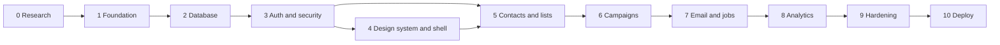

# Cadentra: Implementation Roadmap

Status: **all phases implemented** on branch `feat/cadentra-mvp`. This file keeps the original plan; the notes below say where reality differed. Nothing is merged to `main` without your approval.

## Where it ended up

| Phase                     | Planned                                      | Actual                                                                                                           |
| ------------------------- | -------------------------------------------- | ---------------------------------------------------------------------------------------------------------------- |
| 1 Foundation              | Express skeleton, config, errors, CI         | Done as planned. `dotenv` was unnecessary (Node's `--env-file`)                                                  |
| 2 Database                | Schema, migrations, constraints, claim query | Done. The Prisma and isolation-level spikes had real findings (DECISIONS D-04, D-17, D-18)                       |
| 3 Auth and security       | Sessions, CSRF, rate limits                  | Done. `GET /auth/session` added (D-26)                                                                           |
| 4 Design system and shell | Tokens, shell, components                    | Done, built alongside the pages rather than before contacts, because the pages needed it                         |
| 5 Contacts and lists      | CRUD, import, suppression                    | Done                                                                                                             |
| 6 Campaigns               | Lifecycle, builder                           | Done                                                                                                             |
| 7 Email and jobs          | Provider, worker, webhooks, unsubscribe      | Done. Real Resend not exercised (no credentials)                                                                 |
| 8 Analytics               | Dashboard and analytics                      | Done, with a seed script so screens have data                                                                    |
| 9 Hardening               | Review, audit, a11y                          | Done: headers, rate limit on the unsubscribe route, CSV formula guard, axe scan and its fixes, query-plan review |
| 10 Deployment             | Deploy, README, screenshots                  | **Packaging and docs done; not deployed.** Image verified locally. See DEPLOYMENT.md                             |

The original plan follows.

## Phase dependencies



Phase 4 (visual shell) only needs authentication to exist. It comes before Phase 5 so that contacts, campaigns and analytics are built directly in the real interface and never as throwaway markup.

## Quality gate (every phase)

Run, in this order, and report the result of each: `npm run typecheck`, `npm run lint`, `npm run format:check`, `npm test`, `npm run build`. Nothing is committed red, and a failing test is fixed, never weakened or deleted.

## Phase 1: Foundation and development environment

**Builds.** A running, tested, linted TypeScript server with configuration, logging, error handling, a health endpoint, a minimal static page, and CI.

**Files created.**

```
package.json            tsconfig.json         eslint.config.js
.prettierrc.json        .prettierignore       .nvmrc            .env.example
.github/workflows/ci.yml
src/server.ts           src/app.ts            src/config/env.ts
src/lib/logger.ts       src/lib/errors.ts     src/middleware/error-handler.ts
src/middleware/not-found.ts                   src/modules/health/health.routes.ts
src/public/index.html   src/public/css/tokens.css   src/public/js/main.js
tests/health.test.ts    tests/errors.test.ts  tests/env.test.ts
```

**Dependencies (to be installed with versions checked at install time).**

| Package                                                                                | Why                                                      |
| -------------------------------------------------------------------------------------- | -------------------------------------------------------- |
| `express`                                                                              | HTTP framework                                           |
| `zod`                                                                                  | Validate environment variables now, request bodies later |
| `pino`, `pino-http`                                                                    | Structured logging and request logs                      |
| `helmet`                                                                               | Secure headers, including CSP                            |
| dev: `typescript` (6.0.x), `tsx`                                                       | Compile and run TypeScript with watch mode               |
| dev: `@types/node`, `@types/express`                                                   | Type definitions                                         |
| dev: `vitest`, `supertest`, `@types/supertest`                                         | Tests                                                    |
| dev: `eslint`, `@eslint/js`, `typescript-eslint`, `eslint-config-prettier`, `prettier` | Lint and format                                          |
| dev: `pino-pretty`                                                                     | Readable logs in development                             |

Not added yet: `dotenv` (Node's `--env-file` should replace it, to be confirmed), Prisma, `express-rate-limit`, `argon2`, `csv-parse`, `resend`, `svix`. Each arrives in the phase that uses it. Docker Compose arrives in Phase 2, when MySQL is first needed.

**What you will learn.** `tsconfig` options that matter (`strict`, `module: nodenext`, `noUncheckedIndexedAccess`), why `app.ts` is separate from `server.ts` (testing without opening a port), validating the environment at startup so a bad deploy fails immediately, Express 5 async errors, graceful shutdown with SIGTERM.

**Acceptance criteria.**

1. `npm run dev` starts the server with reload. `GET /healthz` returns 200 with a small JSON body.
2. Starting with a missing or invalid required environment variable exits with a clear message and a non-zero code.
3. An unknown route returns a JSON 404. A thrown error inside an async route returns a JSON 500 with no stack trace in production mode.
4. SIGTERM closes the server and exits 0 after in-flight requests finish.
5. The static page is served with a CSP header and no inline script.
6. All gate commands pass locally, and the CI workflow passes on GitHub.

**Tests.** Health endpoint, 404 shape, error handler shape (including a deliberately throwing route), environment parsing with valid and invalid input.

**Git.** Branch `chore/foundation`. Commits such as `chore: initialize TypeScript project`, `feat: add config and error handling`, `ci: add GitHub Actions workflow`.

**Prerequisite from you.** Start Docker Desktop before Phase 2. Decide how GitHub authentication will work (see the Phase 0 report).

## Phase 2: Database and data access

**Builds.** Docker Compose MySQL 8.4, Prisma schema and migrations for the MVP tables, hand-written constraints, seed script, repositories, and database tests.
**Starts with** the five spikes in DATABASE_DESIGN section 9.
**Acceptance.** Migrations apply cleanly to an empty database and in CI. Cross-tenant link attempts fail at the database. Unique constraints reject duplicates. `EXPLAIN` output for queries Q1 to Q12 shows the intended indexes. `/readyz` reports database status. Seed populates a usable dataset.
**Tests.** Constraint tests (each unique key and the composite foreign keys), transaction rollback, claim query with two competing connections never returning the same row.
**Git.** Branch `feat/database`.

## Phase 3: Authentication and security

**Builds.** Register, login, logout, sessions, auth and tenant middleware, rate limits, secure headers and cookies, CSRF defence, audit log entries, account endpoints (profile, change password, list and revoke sessions). Writes `SECURITY.md`.
**Acceptance.** Registration creates user, workspace and membership atomically. Wrong password and unknown email return the same response. Session cookie has the intended attributes. Revoked and expired sessions are refused. Rate limit triggers on repeated login attempts. Every protected route returns 401 without a session.
**Tests.** Auth flows, cookie attributes, session expiry and revocation, rate limiting, a cross-tenant authorization test pattern reused by later phases.
**Git.** Branch `feat/auth`.

## Phase 4: Design system and application shell

**Builds.** Tokens, base styles, components, the router and API client, login and registration screens, sidebar shell, toast and modal, loading and empty states, responsive layout, accessibility basics.
**Acceptance.** Login and logout work end to end. Navigation moves between real (even if initially empty) pages. Keyboard navigation and visible focus work. Layout works at 375px and at 1440px. Reduced-motion is respected. Contrast meets the table in PRODUCT_REQUIREMENTS.
**Tests.** API client and router unit tests where logic exists, a first Playwright test (register, log in, log out). Manual review of screenshots at three widths.
**Git.** Branch `feat/app-shell`.

## Phase 5: Contacts and lists

**Builds.** Contact CRUD, consent fields, search, filters, cursor pagination, lists, CSV import with row-level error report, suppression list view and manual suppression, frontend for all of it.
**Acceptance.** Duplicate email in one workspace is rejected with a clear message. Import reports created, duplicate and invalid rows with row numbers. A user in another workspace cannot see or change these records. Import refuses missing consent basis.
**Tests.** Validators, CSV parser edge cases (quotes, BOM, blank lines, oversize), CRUD and authorization integration tests, a Playwright import flow.
**Git.** Branch `feat/contacts`.

## Phase 6: Campaign management

**Builds.** Campaign CRUD, steps editor, audience selection, schedule and sending window, lifecycle transitions with optimistic locking, launch gates (sender identity, postal address, consent), campaign builder UI and detail page. Launch creates recipients and the first messages in one transaction, but nothing is sent yet.
**Acceptance.** Illegal transitions return 409. Two concurrent edits cannot silently overwrite each other. Launch excludes suppressed contacts. A draft cannot launch without steps.
**Tests.** Transition table unit tests, versioned-update test, launch transaction test (including rollback), authorization tests.
**Git.** Branch `feat/campaigns`.

## Phase 7: Email integration and background jobs

**Builds.** Provider interface, Resend and fake providers, message renderer with unsubscribe link and headers, claim loop with leases, retry policy, `computeRunAt`, rate limiting and daily cap, circuit breaker, graceful shutdown, webhook receiver with signature verification, suppression side effects, public unsubscribe page and one-click endpoint.
**Acceptance.** A campaign with fake-provider sends goes through every status. Killing the worker mid-send and restarting produces no duplicate. A forged webhook is rejected. A duplicate webhook is acknowledged and ignored. An out-of-order webhook does not move a message backwards. An unsubscribe stops later steps. A sandbox run with `delivered@`, `bounced@` and `complained@` addresses shows the correct statuses.
**Tests.** Retry classification table, scheduling maths including DST, claim concurrency, crash-recovery test, webhook signature and idempotency tests, end-to-end send with the fake provider. Sandbox run is manual and recorded in `TESTING.md`.
**Git.** Branch `feat/email-jobs`.

## Phase 8: Analytics and dashboard

**Builds.** Aggregate queries, dashboard and campaign analytics APIs and screens, date filters, empty and error states, small SVG charts.
**Acceptance.** Every number on screen is derived from rows and matches a direct SQL count in tests. Delivery and bounce rates use the definitions in PRODUCT_REQUIREMENTS. An empty workspace shows meaningful empty states, not zeros dressed up as data.
**Tests.** Analytics maths unit tests, aggregate integration tests against seeded data, `EXPLAIN` review.
**Git.** Branch `feat/analytics`.

## Phase 9: Quality, optimisation and hardening

**Builds.** Full regression run, security review against the OWASP Top Ten, dependency audit, query review and index adjustments from `EXPLAIN` evidence, accessibility pass, responsive pass, error-state review, API review, `API_REFERENCE.md`, `TESTING.md`.
**Acceptance.** No known high or critical audit findings. Every list endpoint is paginated and bounded. Documented performance observations rather than guesses.
**Git.** Branch `chore/hardening`.

## Phase 10: Deployment and final presentation

**Builds.** `Dockerfile`, production configuration, hosting and managed MySQL per D-14, webhook endpoint registered with Resend, deployment smoke test, `DEPLOYMENT.md`, final README with screenshots and an architecture diagram.
**Acceptance.** The live URL serves the app over HTTPS. `/healthz` and `/readyz` pass. A scheduled campaign sends and its status updates arrive through the production webhook. Nothing is called "deployed" until I have loaded the live URL and exercised these paths.
**Git.** Branch `chore/deployment`.

## Git strategy

- `main` stays stable and receives changes only through pull requests that you approve.
- One branch per phase, named as above. Small, logical commits in conventional-commit style (`feat:`, `fix:`, `chore:`, `test:`, `docs:`, `ci:`).
- Before each commit: review `git status` and the staged diff, add files by name (never a blind `git add .`), confirm no `.env` and no secrets are staged.
- No force pushes, no history rewriting.
- Each commit message ends with the attribution line you have configured for this project.

### The bootstrap problem

The remote `main` does not exist yet, so the first pull request has nothing to merge into. Proposed resolution, needing your approval:

1. Locally, `main` holds one initial commit containing only `.gitignore` and `README.md`.
2. The Phase 0 documents live on branch `docs/phase-0-blueprint`.
3. You push `main` once (or approve me doing it once authentication works), then `docs/phase-0-blueprint`, and open a pull request.
4. You review and merge the Phase 0 pull request yourself.
